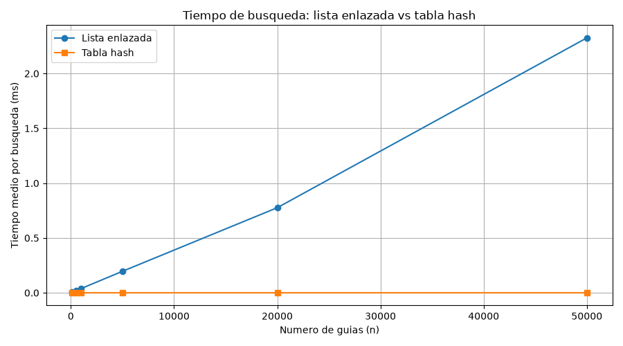
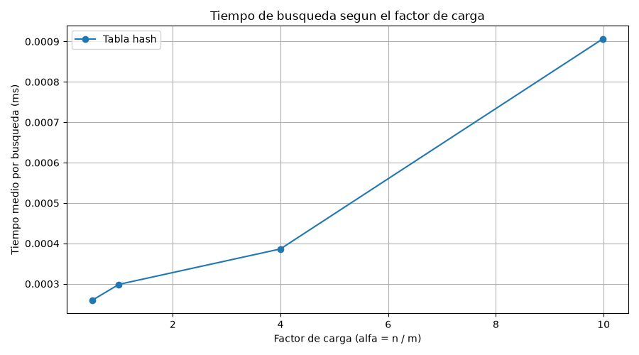

# Laboratorio evaluativo 03 — Estructuras de datos

**Estudiante:** Julián David Agudelo Acevedo  
**Curso:** Análisis de Algoritmos

## 1. Objetivo

Comparar el tiempo de búsqueda de guías de envío en una lista
enlazada y una tabla hash con encadenamiento. También se estudia
cómo afecta el factor de carga y cuándo sería útil un árbol de
búsqueda binario.

## 2. Implementación y pruebas

En `estructuras.py` se implementaron las clases `Nodo`,
`ListaEnlazada` y `TablaHash`.

La lista inserta al inicio y busca recorriendo los nodos.
La tabla utiliza `guia % m` y almacena las colisiones en listas
enlazadas.

En `pruebas.py` se verificaron búsquedas exitosas e
inexistentes, colisiones forzadas con las guías 10, 24 y 17
en una tabla de 7 casillas, y 20 colecciones aleatorias.

Las pruebas terminaron correctamente y los archivos pasaron
la revisión de estilo PEP 8.

## 3. Cómo ejecutar

Desde la carpeta `lab3-estructuras-datos`:

```bash
python pruebas.py
python medicion.py
```

Para verificar el estilo:

```bash
python -m pycodestyle estructuras.py pruebas.py medicion.py
```

Las dependencias utilizadas para las gráficas son `matplotlib`
y las herramientas indicadas en el repositorio del curso.

## 4. Mediciones

Se realizaron 200 búsquedas de guías inexistentes por prueba,
con tres repeticiones y semillas fijas. Se utilizó
`time.perf_counter()` para medir únicamente las búsquedas,
sin incluir la construcción de las estructuras.

### Experimento A: comparación por tamaño

| n | m | α | Lista (ms) | Hash (ms) |
|---:|---:|---:|---:|---:|
| 100 | 53 | 1.887 | 0.004058 | 0.000223 |
| 500 | 251 | 1.992 | 0.019060 | 0.000258 |
| 1000 | 503 | 1.988 | 0.038760 | 0.000322 |
| 5000 | 2503 | 1.998 | 0.195986 | 0.000305 |
| 20000 | 10007 | 1.999 | 0.776075 | 0.000322 |
| 50000 | 25013 | 1.999 | 2.325159 | 0.000325 |



### Experimento B: factor de carga

Se mantuvieron 20.000 guías y se modificó el número de casillas.

| m | α | Tiempo hash (ms) |
|---:|---:|---:|
| 40009 | 0.500 | 0.000259 |
| 20011 | 0.999 | 0.000299 |
| 5003 | 3.998 | 0.000386 |
| 2003 | 9.985 | 0.000907 |



## 5. Análisis

### 1. Complejidad de una búsqueda inexistente

En la lista enlazada, cuando una guía no existe, hay que
recorrer todos los nodos para comprobarlo. Por eso su costo
es Θ(n).

En la tabla hash primero se calcula la casilla y después
se recorre solamente su cadena. Si las guías se distribuyen
uniformemente, el costo esperado es Θ(1 + α), donde
α = n / m. En el peor caso, si todas las guías colisionan,
también puede llegar a Θ(n).

### 2. Relación entre teoría y mediciones

En la primera gráfica se observa que la lista enlazada
aumenta su tiempo conforme crece n, mientras que la tabla
hash se mantiene casi horizontal.

De 1.000 a 5.000 guías, n se multiplica por 5 y el tiempo
de la lista aumenta aproximadamente 5,06 veces. Esto se
acerca al crecimiento lineal esperado. En cambio, el tiempo
de la tabla cambia de 0,000322 a 0,000305 ms, una variación
pequeña porque α permanece cercano a 2.

En la segunda gráfica, al aumentar α de 0,500 a 9,985,
el tiempo pasa de 0,000259 a 0,000907 ms. Esto muestra
que las cadenas más largas pueden aumentar el costo de
búsqueda. Los tiempos no siguen una proporción exacta
porque también influyen los costos fijos y las variaciones
de la medición.

### 3. Colisiones y métodos para resolverlas

Una colisión ocurre cuando dos claves diferentes producen
la misma posición. Puede suceder incluso si hay más
casillas que guías.

Por ejemplo, con m = 7, las claves 10, 24 y 17 producen
el índice 3. En nuestra implementación se conservan las
tres mediante encadenamiento.

El encadenamiento permite guardar varias claves por
casilla, incluso cuando α supera 1, aunque necesita
memoria adicional para los nodos. El direccionamiento
abierto busca otra posición disponible dentro del arreglo,
pero requiere controlar el sondeo, la ocupación y las
eliminaciones.

### 4. Consultas por rango y árboles binarios

La tabla hash sirve para encontrar una guía exacta, pero
no mantiene las claves ordenadas. Para consultar todas las
guías entre X y Y habría que revisar la tabla completa.

Un árbol de búsqueda binario permite aprovechar el orden.
Una consulta por rango puede costar O(h + k), donde h es
la altura y k la cantidad de resultados.

Sin embargo, si se insertan 400.000 claves ordenadas en
un BST común, puede degenerar hasta una altura de 399.999.
Un árbol balanceado mantiene una altura O(log n), cercana
a 19 niveles para esa cantidad de guías.

### 5. Recomendación para Rutas del Caribe

Para las consultas por número exacto de guía utilizaría
una tabla hash con encadenamiento, procurando mantener
controlado el factor de carga.

Si también se necesitan consultas frecuentes por rango,
convendría complementarla con un árbol balanceado.

En el experimento A, la lista tardó 2,325159 ms por
búsqueda con 50.000 guías. Si se extrapola su crecimiento
lineal a 5 millones, el tiempo estimado sería unas 100
veces mayor, aproximadamente 232,5 ms por búsqueda.

En la tabla hash, el costo esperado podría mantenerse
cercano al actual si el número de casillas creciera junto
con las guías para conservar α alrededor de 2. Esta última
comparación es una estimación teórica, no una medición
real con 5 millones de registros.